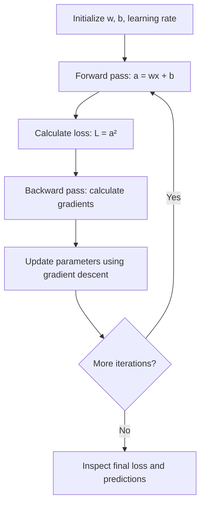

---
tags:
  - tinygpt
  - machine-learning
  - python
  - backpropagation
  - gradient-descent
created: 2026-10-18
status: completed
---

# Implementing Gradient Descent in Python

> [!summary] Key idea
> A neural network training step consists of a **forward pass** (compute the output and loss), **backpropagation** (compute parameter gradients), and an **optimizer step** (update parameters using those gradients). We can implement this entire process in plain Python, without PyTorch or automatic differentiation. Repeating the steps lets us observe convergence, oscillation, and divergence.

> [!info] Where this note comes from
> Based on my Stage 4 exercises and the code in [gradient_descent.ipynb](../notebooks/04-gradient-descent.ipynb). The notebook contains the executable experiments; this note records what they mean, expected results, mistakes corrected along the way, and the conclusions I should remember. Prerequisites: [[01-derivatives]], [[02-gradient-descent]], and [[03-chain-rule-backpropagation]].

## 1. Our model and learning objective

We start with a **single input**, a **weight**, and a **bias**:

$$
a=wx+b
$$

For this first experiment, the loss is:

$$
L=a^2=(wx+b)^2
$$

- $x$: fixed input value.
- $w$: trainable **weight**.
- $b$: trainable **bias**.
- $a$: model output (prediction).
- $L$: loss to minimize.
- $\eta$ or `lr`: **learning rate**.

We set:

$$
w=3,\qquad x=2,\qquad b=1,\qquad \eta=0.01
$$

Our goal is to make $a$ approach **zero**, which makes $L$ approach zero. This is a deliberately simplified learning problem; later we will use explicit target outputs.

## 2. Environment: Python and Jupyter

I used Python in a Jupyter notebook on my Mac (Antigravity, a VS Code-based IDE). Jupyter can run different pieces of the training process in separate cells, making the intermediate values easier to inspect.

My Homebrew Python rejected a global `pip install` with an **externally-managed-environment** error. The right approach was to create and use a project-specific virtual environment:

```bash
python3 -m venv .venv
source .venv/bin/activate
python -m pip install jupyter ipykernel matplotlib
```

The notebook should select the `.venv` Python interpreter as its kernel. The virtual environment should **not** be committed to GitHub; add `.venv/` to `.gitignore`.

> [!tip] Jupyter keeps state between cells
> Variables persist and can be overwritten by later cells. The order in which I **execute** cells matters, not just their visual order. When checking reproducibility, use **Restart Kernel and Run All** so every result comes from a clean initial state.

## 3. Forward pass

The **forward pass** uses the current parameters to calculate the output and loss.

```python
w = 3.0
x = 2.0
b = 1.0

a = w * x + b
L = a ** 2

print("Output:", a)
print("Loss:", L)
```

By hand:

$$
\begin{aligned}
a&=3(2)+1=\boxed{7}\\
L&=7^2=\boxed{49}
\end{aligned}
$$

Expected output:

```text
Output: 7.0
Loss: 49.0
```

**Important Python operators:** `*` means multiplication, `+` means addition, and `**` means exponentiation (so `a ** 2` squares `a`).

## 4. Backpropagation: calculate gradients

We derived these gradients in [[03-chain-rule-backpropagation]]:

$$
\begin{aligned}
\frac{\partial L}{\partial w}&=2ax\\
\frac{\partial L}{\partial b}&=2a
\end{aligned}
$$

Implement them directly in Python:

```python
dL_dw = 2 * a * x
dL_db = 2 * a

print("Weight gradient:", dL_dw)
print("Bias gradient:", dL_db)
```

With $a=7$ and $x=2$:

$$
\begin{aligned}
\frac{\partial L}{\partial w}&=2(7)(2)=\boxed{28}\\
\frac{\partial L}{\partial b}&=2(7)=\boxed{14}
\end{aligned}
$$

Expected output:

```text
Weight gradient: 28.0
Bias gradient: 14.0
```

These are **gradients of the loss with respect to the parameters**, not parameter updates. They tell us how sensitive the loss is to small changes in $w$ and $b$.

> [!important] Backpropagation does not update weights
> **Forward pass:** compute outputs and loss. **Backpropagation:** compute gradients. **Gradient descent:** use those gradients to update parameters. This distinction was one of my conceptual corrections during the lesson.

## 5. Gradient descent: update the parameters

Use the gradient descent rule:

$$
\begin{aligned}
w_{\text{new}}&=w-\eta\frac{\partial L}{\partial w}\\
b_{\text{new}}&=b-\eta\frac{\partial L}{\partial b}
\end{aligned}
$$

With $\eta=0.01$:

$$
\begin{aligned}
w_{\text{new}}&=3-0.01(28)=\boxed{2.72}\\
b_{\text{new}}&=1-0.01(14)=\boxed{0.86}
\end{aligned}
$$

A single update in Python:

```python
lr = 0.01
w = w - lr * dL_dw
b = b - lr * dL_db

a = w * x + b
L = a ** 2

print("After 1 iteration")
print("Output:", a)
print("Loss:", L)
```

The new output and loss are:

$$
\begin{aligned}
a_{\text{new}}&=2.72(2)+0.86=\boxed{6.3}\\
L_{\text{new}}&=6.3^2=\boxed{39.69}
\end{aligned}
$$

| | Before update | After one update |
|---|---:|---:|
| $w$ | 3.0 | 2.72 |
| $b$ | 1.0 | 0.86 |
| $a$ | 7.0 | 6.3 |
| $L$ | 49.0 | 39.69 |

> [!warning] Saved notebook output may not match the code
> At the time I documented this lesson, the committed **single-update cell** showed a saved output of approximately `5.6` and `31.36`, and an older label `After 1 epoch`. Those do **not** match a single update starting at $w=3,b=1$; the correct result is $a=6.3,L=39.69$. Rerunning a cell that **mutates** $w$ and $b$ can apply another update to already-updated parameters, and notebook outputs can remain from earlier executions. **Restart the kernel and run all cells in order** to check.

## 6. A training loop: repeat all three steps

Instead of updating parameters by hand, put all three operations inside a `for` loop.

```python
w = 3.0
x = 2.0
b = 1.0
lr = 0.01

loss_history = []

for i in range(10):
    # 1. Forward pass
    a = w * x + b
    L = a ** 2
    loss_history.append(L)

    # Print values that belong to the SAME parameter state
    print(f"Iteration {i}")
    print("Weight:", w)
    print("Bias:", b)
    print("Loss:", L)

    # 2. Backpropagation
    dL_dw = 2 * a * x
    dL_db = 2 * a

    # 3. Gradient descent
    w = w - lr * dL_dw
    b = b - lr * dL_db
```

### Why recalculate gradients inside the loop?

Gradients are **local**: they depend on the **current** parameters and intermediate values. If I compute `dL_dw` and `dL_db` just once outside the loop, every step uses outdated slopes.

For example, with $\eta=0.01$:

| Update | Output used to compute gradient | Weight gradient | Bias gradient |
|---|---:|---:|---:|
| First | $7$ | $28$ | $14$ |
| Second | $6.3$ | $25.2$ | $12.6$ |

The gradients get smaller as $a$ approaches zero, so the updates also become smaller.

### Why print before updating?

The forward-pass loss is based on the **old** $w$ and $b$. Printing loss after changing $w$ and $b$ without recomputing the forward pass can mix different parameter states in one log.

This loop prints all three values **before the update**. For the initial learning rate:

| Displayed iteration | $w$ | $b$ | Loss |
|---:|---:|---:|---:|
| 0 | 3.0 | 1.0 | 49.0 |
| 1 | 2.72 | 0.86 | 39.69 |
| 2 | 2.468 | 0.734 | 32.1489 |

The code performs **10 updates**, but the last displayed loss is measured **before the tenth update**. To display the loss *after* that final update, run another forward pass after the loop.

> [!note] Iteration versus epoch
> A **training iteration/step** is a parameter update. An **epoch** is a complete pass through the training dataset. With our single-example dataset, one update can correspond to one epoch, but later, with multiple examples and minibatches, these terms will mean different things.

## 7. Visualizing the loss using Matplotlib

Record the loss during each forward pass:

```python
loss_history.append(L)
```

Plot it after the loop:

```python
import matplotlib.pyplot as plt

plt.plot(loss_history)
plt.xlabel("Iteration")
plt.ylabel("Loss")
plt.title("Training Loss")
plt.show()
```

**Observation from the experiment:** the loss followed a curve, dropping relatively quickly at first and more slowly near zero.

**Why?**

$$
\frac{\partial L}{\partial w}=2ax,\qquad
\frac{\partial L}{\partial b}=2a
$$

As $a\to0$, both gradients approach zero. With a fixed learning rate, that makes the changes to $w$ and $b$ smaller. This behavior is true for our simple model; a real neural network's loss does not have to decrease smoothly.

## 8. Learning-rate experiment

I tested the same model with $\eta=0.01,\ 0.1,\ 0.2,$ and $0.3$, resetting the initial parameters before each test.

| Learning rate | What I observed | Interpretation |
|---:|---|---|
| **0.01** | Loss decreases gradually | **Convergence** with small steps |
| **0.1** | Loss reaches zero after one update | Reaches a minimum exactly for this problem |
| **0.2** | Loss graph is flat at $49$ | **Oscillation**: outputs alternate $+7,-7$ |
| **0.3** | Loss grows rapidly | **Divergence** due to increasingly large overshoots |

### Why does $\eta=0.1$ work in one step?

At the initial $w=3,b=1$ with gradients $28$ and $14$:

$$
\begin{aligned}
w_{\text{new}}&=3-0.1(28)=\boxed{0.2}\\
b_{\text{new}}&=1-0.1(14)=\boxed{-0.4}\\
a_{\text{new}}&=0.2(2)-0.4=0\\
L_{\text{new}}&=\boxed{0}
\end{aligned}
$$

An output may appear as a tiny nonzero number in Python (e.g. $10^{-31}$) due to floating-point rounding. That is effectively zero here.

### Why does $\eta=0.2$ produce a flat loss?

Starting with $a=7$:

$$
\begin{aligned}
w_{\text{new}}&=3-0.2(28)=-2.6\\
b_{\text{new}}&=1-0.2(14)=-1.8\\
a_{\text{new}}&=-2.6(2)-1.8=\boxed{-7}\\
L_{\text{new}}&=(-7)^2=\boxed{49}
\end{aligned}
$$

The next gradients are $-28$ and $-14$, returning the parameters to $w=3,b=1$. **The parameters are changing even though the loss is constant.**

### Why does $\eta=0.3$ diverge?

At any step, since $x=2$ is fixed:

$$
\begin{aligned}
w_{\text{new}}&=w-\eta(2ax)\\
b_{\text{new}}&=b-\eta(2a)\\
a_{\text{new}}&=xw_{\text{new}}+b_{\text{new}}\\
&=a-2\eta a(x^2+1)\\
&=\boxed{(1-10\eta)a}
\end{aligned}
$$

Therefore:

$$
\boxed{L_{\text{new}}=(1-10\eta)^2L}
$$

This explains **all four** outcomes:

| $\eta$ | Output multiplier $1-10\eta$ | Loss multiplier $(1-10\eta)^2$ |
|---:|---:|---:|
| 0.01 | 0.9 | 0.81 |
| 0.1 | 0 | 0 |
| 0.2 | -1 | 1 |
| 0.3 | -2 | 4 |

At $\eta=0.3$, each update **quadruples** the loss: $49\to196\to784\to\cdots$.

> [!important] These specific learning-rate thresholds are not universal
> They arise from this exact function and fixed input $x=2$. Different models, data, and loss landscapes can have very different stable learning rates.

## 9. Zero loss does not require zero parameters

In our experiment:

$$
L=(2w+b)^2
$$

For zero loss, we only need:

$$
\boxed{2w+b=0}
$$

Many parameter pairs satisfy this, such as:

| $w$ | $b$ | Output at $x=2$ |
|---:|---:|---:|
| 0 | 0 | 0 |
| 1 | -2 | 0 |
| 0.2 | -0.4 | 0 |

I also compared two models that both achieve zero loss for $x=2$:

| Model | Parameters | Prediction at $x=2$ | Prediction at $x=3$ |
|---|---|---:|---:|
| A | $w=0,b=0$ | 0 | 0 |
| B | $w=1,b=-2$ | 0 | 1 |

Both perfectly fit the **one training input**, but they disagree on an **unseen input**.

**Lesson:** a model can achieve zero *training loss* without having uniquely determined parameters or necessarily generalizing well. We need more data and clear target outputs to assess predictions on new inputs.

## 10. Common mistakes and what I learned from them

- **Multiplication versus addition:** I initially wrote `a = w * x * b` in a loop. The actual forward pass is `a = w * x + b`. Keeping gradients derived for the addition model while implementing multiplication gives incorrect optimization.
- **Stale gradients:** If I update the parameters but do not rerun backpropagation, subsequent steps reuse the wrong gradients.
- **Mismatched logging:** Printing the pre-update loss alongside post-update parameters makes iteration output misleading.
- **Notebook state:** Rerunning cells can mutate parameters unexpectedly; restarting the kernel gives a fresh, reproducible execution.
- **Gradient versus loss:** A gradient determines the local update direction. We do not subtract the raw loss from the weight.
- **Zero loss versus zero weights:** Different parameter combinations can produce the same prediction on one example.

## 11. The training process at a glance



## 12. Quick self-check (without looking at the answers)

- [ ] Why must the forward pass be computed before evaluating the gradients in this example?
- [ ] What is the difference between backpropagation and gradient descent?
- [ ] Why must gradients be recomputed at every iteration?
- [ ] What is wrong with writing `a = w * x * b` while keeping gradients for `a = w * x + b`?
- [ ] Why do we print the parameters and loss before updating them in this implementation?
- [ ] Why does $\eta=0.2$ keep the loss constant even when the parameters change?
- [ ] Why does $\eta=0.3$ make the loss grow by a factor of four per update?
- [ ] Why can two models that both have zero loss on $x=2$ disagree at $x=3$?
- [ ] How does an **iteration** differ from an **epoch**?

## 13. What comes next

**[[05-training-multiple-examples]]** — replace our zero-target loss with a loss against a real target:

$$
L=(a-y)^2
$$

Then use several $(x,y)$ pairs and learn how to calculate and aggregate gradients across a dataset. This is the bridge from our one-example exercise to training a model that learns relationships from data.
